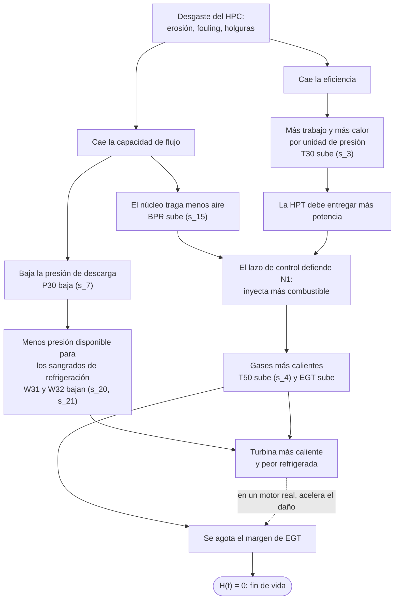

# 01 · Teoría de dominio: física del turbofán y confiabilidad

Este documento explica **qué se degrada, por qué y cómo se ve en los sensores**, sin entrar en software. Es la base para justificar cada decisión de modelado de los documentos [02](02_process_architecture.md) y [03](03_logical_architecture.md).

> **Origen de las cifras.** Lo que se dice del simulador proviene de Saxena et al. (2008) [1]. Las cifras marcadas con **(FD001)** se calcularon sobre los archivos reales del dataset.

---

## 1. El motor turbofán comercial

### 1.1 Principio de funcionamiento

Un turbofán produce empuje acelerando aire hacia atrás. El fan mueve una gran masa de aire y la divide en dos corrientes:

- **Flujo de bypass (frío).** Rodea el núcleo y sale por la tobera de bypass. En motores comerciales genera la mayor parte del empuje.
- **Flujo de núcleo (caliente).** Se comprime, se mezcla con combustible, se quema y se expande en las turbinas, que entregan la potencia que mueve al fan y a los compresores.

La relación entre ambas masas es el **bypass ratio**:

$$
BPR = \frac{\dot m_{\text{bypass}}}{\dot m_{\text{núcleo}}}
$$

C-MAPSS simula un motor comercial grande, de la clase de **90.000 lbf** de empuje [1].

### 1.2 Disposición de los componentes

```
                ┌──────────────── FLUJO DE BYPASS (frío) ────────────────┐
                │                                                        ▼
  Aire    ┌─────┤                                                  Tobera bypass
 ────────▶│ FAN │
          │     ├──▶┌─────┐   ┌─────┐   ┌───────────┐   ┌─────┐   ┌─────┐
          └──┬──┘   │ LPC │──▶│ HPC │──▶│  CÁMARA   │──▶│ HPT │──▶│ LPT │──▶ Tobera
             │      └──┬──┘   └──┬──┘   │ COMBUSTIÓN│   └──┬──┘   └──┬──┘    núcleo
             │         │         │      └─────▲─────┘      │         │
             │         │         │            │ Wf         │         │
             │         │         │       combustible       │         │
             │         │         │                         │         │
             │         │         └═════ EJE N2 (núcleo) ═══┘         │
             │         │                                             │
             └─────────┴═════════════ EJE N1 (fan) ══════════════════┘

 Estación:   2        24        30          40            48        50
            (entrada (salida   (salida     (salida       (salida   (salida
             fan)     LPC)      HPC)        cámara)       HPT)      LPT)
```

| Componente | Función | Eje |
|---|---|---|
| **Fan** | Primera compresión; impulsa el flujo de bypass y alimenta el núcleo | N1 |
| **LPC** (compresor de baja presión) | Compresión inicial del aire del núcleo | N1 |
| **HPC** (compresor de alta presión) | Lleva el aire a la presión de combustión. **Es el componente que falla en FD001** | N2 |
| **Cámara de combustión** | Agrega energía quemando combustible a presión casi constante | – |
| **HPT** (turbina de alta presión) | Extrae potencia de los gases calientes para mover el HPC | N2 |
| **LPT** (turbina de baja presión) | Extrae potencia para mover el fan y el LPC | N1 |

### 1.3 Los dos ejes

Los ejes son concéntricos y **mecánicamente independientes**. Los acopla solamente el gas:

- **N1 (`Nf`, velocidad de fan):** LPT → LPC + fan. Es la variable que sigue el control de empuje.
- **N2 (`Nc`, velocidad de núcleo):** HPT → HPC. Se acomoda libremente al equilibrio termodinámico.

Esta diferencia es clave para leer los datos: el controlador **defiende N1**, de modo que la degradación se manifiesta en las variables que el controlador deja variar (temperaturas, presiones, sangrados, bypass y N2).

### 1.4 El ciclo Brayton

El núcleo opera según un ciclo Brayton: compresión → combustión → expansión. La calidad de la compresión se mide con la **eficiencia isentrópica**, que compara el trabajo ideal con el real:

$$
\eta_c = \frac{T_{30,s} - T_{24}}{T_{30} - T_{24}}
\qquad\text{con}\qquad
T_{30,s} = T_{24}\left(\frac{P_{30}}{P_{24}}\right)^{\frac{\gamma-1}{\gamma}}
$$

Para una misma relación de presiones, **si baja $\eta_c$, sube $T_{30}$**: parte del trabajo termina como calor y no como presión. Es la ecuación que conecta el desgaste del HPC con la firma térmica que mide el sensor `s_3`.

---

## 2. Qué mide el dataset

Cada fila es **una foto por vuelo (ciclo)** tomada cuando el simulador alcanza régimen estable. No hay series dentro del vuelo.

### 2.1 Condiciones operativas

| Variable | Magnitud | Rango en C-MAPSS [1] | En FD001 |
|---|---|---|---|
| `op_setting_1` | Altitud | 0 – 42.000 ft | Nivel del mar: ruido en ±0,0087 |
| `op_setting_2` | Número de Mach | 0 – 0,84 | Ruido en ±0,0006 |
| `op_setting_3` | TRA (ángulo del acelerador) | 20 – 100 | Constante en 100 |

FD001 tiene **un único régimen**, así que toda variación sistemática de los sensores se debe a la degradación. En FD002 y FD004 hay seis regímenes y la variación por condición de vuelo tapa la degradación: ahí hay que normalizar por régimen antes de modelar.

### 2.2 Los 21 sensores

La columna *Tendencia* compara los primeros 20 ciclos con los últimos ciclos de vida (RUL ≤ 5) de los 100 motores de entrenamiento **(FD001)**.

| Sensor | Símbolo | Descripción | Unidad | Tendencia (FD001) |
|---|---|---|---|---|
| `s_1` | T2 | Temperatura total, entrada del fan | °R | Constante |
| `s_2` | T24 | Temperatura total, salida del LPC | °R | ▲ +0,20 % |
| `s_3` | T30 | Temperatura total, salida del HPC | °R | ▲ +0,96 % |
| `s_4` | T50 | Temperatura total, salida de la LPT | °R | ▲ +1,85 % |
| `s_5` | P2 | Presión, entrada del fan | psia | Constante |
| `s_6` | P15 | Presión total, ducto de bypass | psia | Cuasi constante (2 valores) |
| `s_7` | P30 | Presión total, salida del HPC | psia | ▼ −0,44 % |
| `s_8` | Nf | Velocidad física del fan (N1) | rpm | ▲ +0,007 % |
| `s_9` | Nc | Velocidad física del núcleo (N2) | rpm | ▲ +0,46 % (**bidireccional**) |
| `s_10` | epr | Relación de presiones del motor (P50/P2) | – | Constante |
| `s_11` | Ps30 | Presión estática, salida del HPC | psia | ▲ +1,65 % |
| `s_12` | phi | Flujo de combustible / Ps30 | pps/psi | ▼ −0,40 % |
| `s_13` | NRf | Velocidad corregida del fan | rpm | ▲ +0,007 % |
| `s_14` | NRc | Velocidad corregida del núcleo | rpm | ▲ +0,36 % (**bidireccional**) |
| `s_15` | BPR | Bypass ratio | – | ▲ +1,20 % |
| `s_16` | farB | Relación combustible/aire en la cámara | – | Constante |
| `s_17` | htBleed | Entalpía de sangrado | – | ▲ +1,01 % |
| `s_18` | Nf_dmd | Velocidad de fan demandada | rpm | Constante |
| `s_19` | PCNfR_dmd | Velocidad corregida de fan demandada | rpm | Constante |
| `s_20` | W31 | Sangrado de refrigeración de la HPT | lbm/s | ▼ −1,24 % |
| `s_21` | W32 | Sangrado de refrigeración de la LPT | lbm/s | ▼ −1,24 % |

Cuatro observaciones con consecuencias para el modelado:

1. **Seis sensores son constantes** (`s_1`, `s_5`, `s_10`, `s_16`, `s_18`, `s_19`) porque reflejan el ambiente o la demanda del control, que no cambian. No aportan información.
2. **`s_6` toma solo dos valores** (21,60 y 21,61). No es de varianza cero, por lo que sobrevive a la poda estricta, pero es casi ruido de redondeo.
3. **Los cambios son muy chicos** (entre 0,007 % y 1,9 %) y están inmersos en ruido. Los sensores informativos se separan entre 3 y 5 desvíos estándar recién al final de la vida. Esto justifica usar ventanas temporales y no una lectura aislada.
4. **`s_9` y `s_14` son bidireccionales:** suben en el 70 % y el 56 % de los motores, respectivamente, y bajan en el resto. Su interpretación depende del motor.

---

## 3. Física de la falla en FD001: degradación del HPC

### 3.1 Qué se degrada

El HPC real pierde prestaciones por **erosión** de los álabes, **ensuciamiento** (*fouling*), aumento de **holguras de punta** (*tip clearance*) y desgaste de sellos. C-MAPSS no simula esos micromecanismos. Los resume en dos modificadores del componente:

- **Eficiencia** `HPC_eff_mod`: más trabajo para lograr la misma compresión.
- **Capacidad de flujo** `HPC_flow_mod`: el compresor traga menos aire a igual velocidad.

El desgaste de cada uno crece de forma exponencial, partiendo de un deterioro inicial $d$ (tolerancias de fabricación, hasta 1 %) [1]:

$$
e(t) = 1 - d_e - \exp\left\lbrace a_e t^{b_e} \right\rbrace
\qquad
f(t) = 1 - d_f - \exp\left\lbrace a_f t^{b_f} \right\rbrace
$$

Los coeficientes se sortean por motor. Por eso dos motores del mismo tipo duran distinto: en FD001 las vidas van de **128 a 362 ciclos** (mediana 199).

### 3.2 Cuándo se considera falla

La falla no es una rotura. Es el momento en que el **índice de salud** llega a cero, y este es el menor de los márgenes operativos normalizados [1]:

$$
H(t) = \min\left(m_{Fan},\ m_{LPC},\ m_{HPC},\ m_{EGT}\right) = 0
$$

(La ecuación 8 del paper menciona la HPT en lugar del LPC; su sección V.D y su tabla 2 usan los márgenes de *stall* de fan, LPC y HPC más el de EGT, que es lo que se reproduce aquí.)

- **Margen de *stall*:** distancia al desprendimiento del flujo en el compresor. Límite: reducción del 15 %.
- **Margen de EGT:** distancia al máximo de temperatura de gases. Límite: alrededor del 2 %.

En las trayectorias que muestra el paper, **el límite que se alcanza primero es el de EGT**. $H(t)$ no se publica: el modelo tiene que inferirlo a partir de los sensores.

### 3.3 La cadena causal



### 3.4 El papel del controlador

El motor se simula en **lazo cerrado** [1]: un controlador de velocidad de fan, más limitadores de velocidad de núcleo, EPR, temperatura de salida de la HPT y presión estática mínima a la salida del HPC. La secuencia es:

1. El HPC degradado entrega menos aire y menos presión.
2. Para sostener la velocidad de fan demandada (`Nf_dmd` = 2388 rpm, constante), el controlador agrega combustible.
3. El empuje se mantiene casi intacto: `Nf` apenas varía un 0,007 % en toda la vida del motor.
4. El costo aparece como temperatura: T50 sube un 1,85 %.

**El controlador enmascara la falla en la variable que controla y la desplaza a las que no controla.** Un monitoreo basado solo en empuje o en N1 no la vería; la firma térmica sí.

### 3.5 Firma termodinámica resumida

| Grupo | Sensores | Dirección | Causa física |
|---|---|---|---|
| Temperaturas | T24, T30, T50 | ▲ | Menor eficiencia y más combustible |
| Presión total de descarga | P30 | ▼ | El HPC comprime menos |
| Bypass | BPR | ▲ | El núcleo acepta menos flujo |
| Refrigeración | W31, W32 | ▼ | Los sangrados se alimentan de la descarga del HPC |
| Entalpía de sangrado | htBleed | ▲ | El aire sangrado sale más caliente |
| Velocidad de núcleo | Nc, NRc | ▲ o ▼ | Equilibrio entre pérdida de eficiencia y de flujo, distinto en cada motor |
| Velocidad de fan | Nf, NRf | ≈ (▲ mínima) | Variable controlada |

Dos aclaraciones para evitar lecturas erróneas:

- **`phi` baja y, sin embargo, el combustible sube.** `phi` es el cociente $W_f / P_{s30}$. Como `Ps30` crece más (+1,65 %) de lo que `phi` cae (−0,40 %), el combustible implícito $W_f = \phi \cdot P_{s30}$ **aumenta alrededor de 1,25 % (FD001)**. Es coherente con la compensación del controlador.
- **`Ps30` y `P30` se mueven en sentidos opuestos** y difieren en un orden de magnitud (unos 47 y 554 psia), algo difícil de conciliar si ambas son presiones a la salida del HPC. El dataset no lo explica. Conviene usar ambas como señales empíricas y **no derivar balances físicos absolutos** de ellas; el cálculo de $W_f$ anterior vale solo como indicador cualitativo.

---

## 4. Ingeniería de confiabilidad

### 4.1 Definición de RUL

El *Remaining Useful Life* es la cantidad de **ciclos de vuelo** que el motor puede completar antes de alcanzar el fin de vida. Para el motor $i$ en el ciclo $t$:

$$
RUL_i(t) = T_i^{EOL} - t
$$

- **Entrenamiento:** las trayectorias llegan a la falla. $T_i^{EOL}$ es el último ciclo registrado, donde el RUL vale 0.
- **Test:** las trayectorias se truncan antes. El RUL del último ciclo lo da `RUL_FD001.txt` (entre 7 y 145 ciclos).

El ciclo es la unidad correcta porque el daño relevante está dominado por los **transitorios** de cada vuelo (arranque, despegue, ascenso, parada) y no solo por las horas de operación.

### 4.2 Por qué no se usa el RUL lineal puro

El RUL lineal supone que el motor "envejece" a ritmo constante y que eso se refleja en los sensores. La física de la sección 3 dice lo contrario: la degradación es exponencial. Durante buena parte de la vida los sensores de un motor sano son **indistinguibles** de los de otro motor sano.

Pedirle al modelo que distinga RUL = 250 de RUL = 200 es pedirle que prediga a partir de ruido. Las consecuencias son concretas:

- La pérdida queda dominada por errores irreducibles en la etapa sana.
- El modelo termina memorizando la longitud de cada trayectoria o la edad del motor.
- Se pierde precisión en la zona que importa: el final de la vida.

### 4.3 RUL lineal a tramos (*Piecewise Linear RUL*)

$$
RUL^{PW}_i(t) = \min\left(RUL_i(t),\ R_{max}\right), \qquad R_{max} = 125
$$

```
 RUL
     │ ╲
     │   ╲   RUL lineal (no observable en esta zona)
     │     ╲
 125 ┤━━━━━━━╲
     │ meseta  ╲
     │ "motor    ╲   tramo lineal
     │   sano"     ╲  "degradación observable"
     │               ╲
   0 ┼────────┬────────╲───▶ ciclos
     0    inicio de     EOL
          degradación
          detectable
```

**Interpretación física.** La meseta equivale a decir "el motor está sano; su vida remanente es *al menos* 125 ciclos". El codo marca el punto a partir del cual la degradación emerge del ruido de medición. Es la versión simplificada de la **curva P-F** de confiabilidad: entre la falla potencial detectable (P) y la falla funcional (F) hay un intervalo en el que el mantenimiento basado en condición puede actuar.

**Por qué 125.** Es una convención de la literatura sobre C-MAPSS, en línea con Heimes (2008), que usó 130 [2]. No es una constante física: **es un hiperparámetro**. Datos de contexto **(FD001)**:

- El 38,9 % de las filas de entrenamiento tiene un RUL lineal mayor a 125. Son las que pasan a la meseta.
- La vida más corta es de 128 ciclos: todos los motores tienen al menos un pequeño tramo de meseta.
- En Test, 11 de 100 motores tienen un RUL real mayor a 125 (máximo 145).

Ese último punto afecta la evaluación: un modelo entrenado con techo no puede acertar esos 11 casos si se lo compara con el RUL sin recortar. Se reportan **ambas variantes**, con el target recortado como métrica principal (ver [02, sección 5](02_process_architecture.md#5-protocolo-de-evaluación)).

**Sentido operativo.** Para planificar mantenimiento no cambia la decisión saber si faltan 140 o 200 vuelos: en ambos casos no se interviene. Sí la cambia distinguir 10 de 25.

---

## 5. NASA Asymmetric Score

### 5.1 Fundamento aeronáutico

Sea $d_i = \widehat{RUL}_i - RUL_i$ el error de predicción del motor $i$.

| | Predicción temprana ($d<0$) | Predicción tardía ($d>0$) |
|---|---|---|
| Qué ocurre | Se baja el motor con vida remanente | El motor supera el límite estando en servicio |
| Consecuencia | Vida útil desperdiciada, taller anticipado | Parada en vuelo, desvío, despegue abortado, daño secundario |
| Naturaleza del costo | Económico, **acotado y planificable** | Operacional y de **seguridad**, potencialmente no acotado |

Son dos errores de la misma magnitud con consecuencias muy diferentes. Una métrica simétrica como el RMSE los trata por igual, por lo que no alcanza para decidir qué modelo es preferible en operación.

### 5.2 Formulación

$$
S = \sum_{i=1}^{n} s_i,
\qquad
s_i =
\begin{cases}
e^{-d_i/13} - 1, & d_i < 0 \quad \text{(temprana)} \\
e^{d_i/10} - 1, & d_i \ge 0 \quad \text{(tardía)}
\end{cases}
$$

$S = 0$ es la predicción perfecta y **menor es mejor**.

> **Errata en la fuente original.** La ecuación 11 de Saxena et al. (2008) asigna $a_1 = 10$ al tramo $d<0$ y $a_2 = 13$ al tramo $d \ge 0$. Tal como está impresa, penalizaría **más** las predicciones tempranas, en contradicción con el propio texto, que indica que las tardías *"were more heavily penalized"*. Este proyecto usa la convención consistente con el texto y habitual en la literatura: **13 para temprana y 10 para tardía**. Es lo que implementa `src/metrics.py`.

### 5.3 Cuánto más cuesta llegar tarde

| Error absoluto (ciclos) | Temprana | Tardía | Tardía / temprana |
|---:|---:|---:|---:|
| 10 | 1,16 | 1,72 | 1,48 |
| 20 | 3,66 | 6,39 | 1,75 |
| 30 | 9,05 | 19,09 | 2,11 |
| 50 | 45,81 | 147,41 | 3,22 |

Las dos ramas son exponenciales, pero la tardía crece con una constante menor. Para errores grandes, la razón entre ambas también crece de forma exponencial:

$$
\frac{s(+|d|)}{s(-|d|)} \approx e^{|d|\left(\frac{1}{10}-\frac{1}{13}\right)} = e^{0{,}0231 |d|}
$$

### 5.4 Propiedades que hay que tener presentes

- **Es una suma, no un promedio.** Solo se comparan scores calculados sobre la misma cantidad de motores.
- **Lo dominan los peores casos.** Un único motor con $d=+60$ aporta unos 402 puntos, más que 60 motores con $d=+20$ (unos 383).
- **No distingue en qué momento de la vida ocurre el error.** El propio paper sugiere dar más peso a los RUL bajos.
- **No reemplaza al RMSE; lo complementa.** RMSE mide la precisión global; el score, el riesgo operativo. Un modelo con mejor RMSE y peor score predice tarde más seguido o con errores tardíos más graves.

---

## Referencias

1. A. Saxena, K. Goebel, D. Simon, N. Eklund, *Damage Propagation Modeling for Aircraft Engine Run-to-Failure Simulation*, PHM08, Denver, 2008. (Incluido en el dataset de Kaggle.)
2. F. O. Heimes, *Recurrent Neural Networks for Remaining Useful Life Estimation*, PHM08, Denver, 2008.
3. D. Frederick, J. DeCastro, J. Litt, *User's Guide for the Commercial Modular Aero-Propulsion System Simulation (C-MAPSS)*, NASA/ARL TM-2007-215026, 2007.
