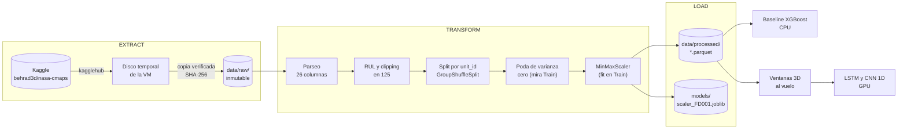
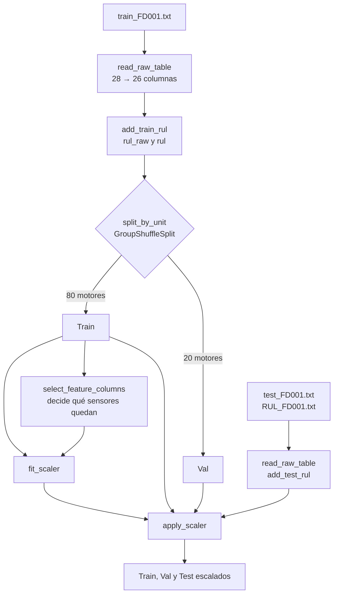
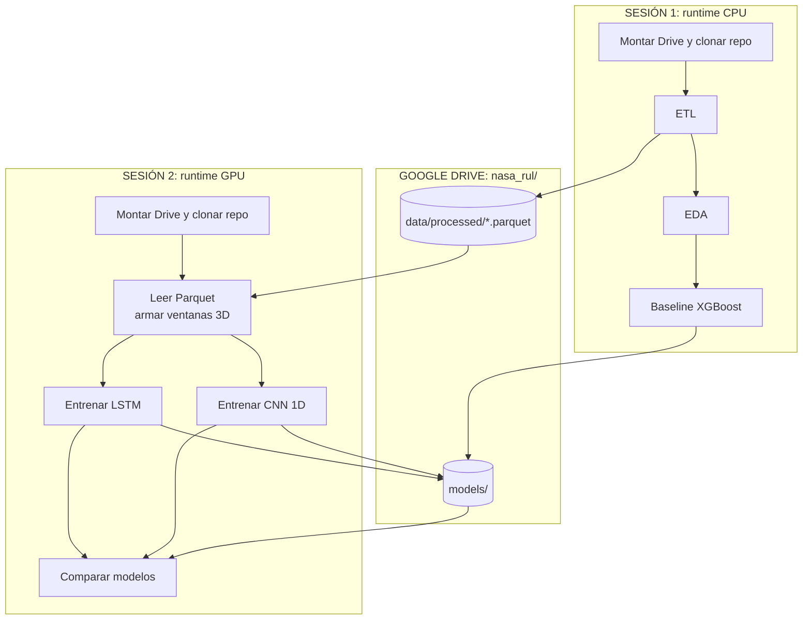

# 02 · Arquitectura de procesos

Describe **cómo fluyen los datos** desde Kaggle hasta un modelo evaluado y **dónde se ejecuta** cada etapa. La física que motiva las decisiones está en [01](01_domain_theory.md); los contratos de cada módulo, en [03](03_logical_architecture.md).

> **Estado.** Este documento es la especificación. `src/config.py`, `src/metrics.py`, `src/etl.py`, `src/dataset.py` y `src/baseline_xgb.py` están implementados; `src/models_dl.py` tiene firmas y docstrings.

---

## 1. Vista general



### Código y datos viven separados

| | Ubicación en Colab | Persistencia | Versionado |
|---|---|---|---|
| Código | `/content/nasa-turbofan-rul` (clon de Git) | Efímera, se vuelve a clonar | Git |
| Datos y modelos | `/content/drive/MyDrive/nasa_rul/` | Permanente | No; se regeneran con el ETL |

`src/config.py` resuelve la raíz de almacenamiento: variable `NASA_RUL_ROOT` → Drive si es Colab → raíz del repo si es local. El resto del código nunca escribe rutas absolutas.

```
/content/drive/MyDrive/nasa_rul/
├── data/
│   ├── raw/                        # .txt originales, nunca se modifican
│   └── processed/
│       ├── train_FD001.parquet
│       ├── val_FD001.parquet
│       ├── test_FD001.parquet
│       └── etl_metadata_FD001.json
├── models/
│   ├── scaler_FD001.joblib
│   ├── xgb_baseline_FD001.json
│   ├── lstm_FD001.pt
│   └── cnn1d_FD001.pt
└── metrics/
    └── xgb_baseline_FD001.json   # métricas, hiperparámetros y top features
```

---

## 2. Extract

| Paso | Detalle |
|---|---|
| Descarga | `kagglehub.dataset_download("behrad3d/nasa-cmaps")` a la caché local de la VM |
| Ubicación | Los `.txt` están en la subcarpeta `CMaps/`; se localizan con búsqueda recursiva |
| Respaldo | Copia de los 12 `.txt` de datos a `data/raw/` de Drive, vía archivo temporal verificado |
| Inmutabilidad | Nunca se sobrescribe. Si el archivo existe, se compara SHA-256; si difiere, el proceso se detiene |
| Idempotencia | Si `data/raw/` ya está completo, no se vuelve a descargar |

**Por qué pasar por el disco temporal.** Drive montado por FUSE es lento con muchas operaciones pequeñas. Descargar y descomprimir en el disco local, y copiar solo el resultado, es más rápido y evita archivos a medio escribir.

**Por qué un respaldo inmutable.** Si el dataset cambia o desaparece de Kaggle, el proyecto sigue siendo reproducible. Además, cualquier error en Transform se corrige volviendo a ejecutar desde `raw`.

### Contenido verificado del dataset

| Subset | Motores train / test | Filas train / test | Vida train (mín – máx) | Regímenes | Fallas |
|---|---|---|---|---|---|
| **FD001** | 100 / 100 | 20.631 / 13.096 | 128 – 362 | 1 | HPC |
| FD002 | 260 / 259 | 53.759 / 33.991 | 128 – 378 | 6 | HPC |
| FD003 | 100 / 100 | 24.720 / 16.596 | 145 – 525 | 1 | HPC, Fan |
| FD004 | 249 / 248 | 61.249 / 41.214 | 128 – 543 | 6 | HPC, Fan |

> El `readme.txt` del dataset indica 248 / 249 motores para FD004. Los archivos contienen lo inverso: 249 en train y 248 en test. No conviene validar contra el readme.

---

## 3. Transform

El orden importa. **Toda decisión aprendida de los datos ocurre después del split.**



### 3.1 Corrección de las dos columnas vacías

Cada línea de los `.txt` termina en **dos espacios**. Con `sep=" "`, pandas interpreta 28 columnas y las 26 y 27 quedan completamente nulas. Se lee con `sep=r"\s+"` (o se descartan esas dos) y se **valida** que el resultado tenga 26 columnas y ningún nulo.

### 3.2 Asignación de los 26 encabezados

`unit_id`, `cycle`, `op_setting_1..3`, `s_1..s_21`. La única definición está en `config.RAW_COLS`.

### 3.3 RUL y clipping

| | Fórmula |
|---|---|
| Train y Val | `rul_raw = max(cycle) − cycle`, por motor |
| Test | `rul_raw = RUL_FD001[motor] + max(cycle) − cycle` |
| Todos | `rul = min(rul_raw, 125)` |

Se conservan ambas columnas: `rul` es el target y `rul_raw` sirve para auditar y reportar. Ninguna de las dos es una feature.

### 3.4 Split Train/Val por motor

`GroupShuffleSplit(n_splits=1, test_size=0.2, random_state=42)` con `groups=unit_id`. En FD001 da **80 motores / 16.561 filas** en Train y **20 motores / 4.070 filas** en Val.

**Por qué es obligatorio.** Con un split aleatorio por filas, los ciclos 100 y 101 de un mismo motor quedarían en particiones distintas. Son casi idénticos y tienen casi la misma etiqueta: el modelo reconocería al motor en lugar de generalizar, y la métrica de validación sería optimista y falsa. Con ventanas de 30 ciclos es peor, porque dos ventanas consecutivas comparten 29 filas.

### 3.5 Poda de sensores de varianza cero

Se calcula **solo en Train** y se aplica la misma lista a Val y Test. En FD001 se eliminan seis: `s_1`, `s_5`, `s_10`, `s_16`, `s_18` y `s_19`. Quedan **15 sensores**.

- **Se usa una tolerancia (`1e-10`), no `== 0`.** `s_5` y `s_16` son constantes, pero su varianza en punto flotante da alrededor de `1e-29` y `1e-35`. Una comparación exacta con cero los dejaría pasar.
- **`s_6` sobrevive** (varianza de aproximadamente `2e-6`, con solo dos valores). Tras el `MinMaxScaler` queda como una señal binaria. Si el EDA confirma que no aporta, se retira de forma explícita y quedan 14 sensores.
- **Las condiciones operativas no entran como features.** En FD001 `op_setting_3` es constante, y las otras dos son ruido sin relación con el RUL (correlación de −0,01).

### 3.6 Escalado

`MinMaxScaler` a [0, 1], **ajustado solo en Train**. Val y Test pueden salir levemente del rango y no se recortan, porque un sensor más allá de lo visto es información. Ajustarlo con todos los datos filtraría al entrenamiento los extremos de Val y Test, que además son los del final de vida.

### 3.7 Checklist anti-leakage

| # | Regla | Verificación |
|---|---|---|
| 1 | Ningún motor en Train y Val a la vez | `set(train.unit_id) & set(val.unit_id) == ∅` |
| 2 | Poda decidida solo con Train | `select_feature_columns` recibe solo Train |
| 3 | Scaler ajustado solo con Train | `scaler.n_samples_seen_ == len(train)` |
| 4 | Ventanas y rolling features dentro de cada motor | Ninguna ventana mezcla `unit_id` |
| 5 | Solo información pasada | Rolling sin `center=True`; ventana `[t − w + 1, t]` |
| 6 | `unit_id`, `cycle`, `rul`, `rul_raw` fuera de las features | Intersección vacía con `feature_cols` |
| 7 | Test se mira una sola vez | Early stopping y tuning usan Val |

`cycle` se excluye de las features a propósito: se sabe en operación y no es leakage estricto, pero lleva al modelo a aprender la vida media de la flota en lugar de la condición del motor.

---

## 4. Load

| Artefacto | Formato | Contenido |
|---|---|---|
| `data/processed/{train,val,test}_FD001.parquet` | Parquet | `unit_id`, `cycle`, features escaladas, `rul`, `rul_raw` |
| `data/processed/etl_metadata_FD001.json` | JSON | `feature_cols`, filas y motores por split, semilla, `RUL_CLIP`, fecha. Se escribe al final: su presencia indica que el ETL terminó |
| `models/scaler_FD001.joblib` | joblib | Scaler ajustado, indispensable para inferencia |

**Por qué Parquet.** Conserva tipos, comprime por columna y se lee de forma selectiva. Como referencia, la tabla de entrenamiento de FD001 pasa de 3,5 MB en `.txt` a cerca de 0,5 MB.

### Por qué se guardan tablas limpias y no las ventanas 3D

| Criterio | Tablas 2D + ventanas al vuelo | Tensores 3D persistidos |
|---|---|---|
| Tamaño (FD001, Train, float32) | 16.561 × 15 × 4 B ≈ **1 MB** | 14.241 × 30 × 15 × 4 B ≈ **26 MB** |
| Cambiar `WINDOW_SIZE` | Un parámetro | Regenerar y volver a subir todo |
| Sirve a XGBoost | Sí | No |
| Auditable | Sí, es una tabla legible | No |
| Fuente de verdad | Una | Dos, que pueden desincronizarse |

Cada fila se repite hasta 30 veces en los tensores. Por eso los tensores se arman en RAM al crear los DataLoaders y **nunca se persisten**: construirlos toma menos de un segundo en FD001. El ahorro es modesto en FD001, pero el argumento de fondo es el de **flexibilidad y fuente única**.

---

## 5. Protocolo de evaluación

| Conjunto | Filas evaluadas | Uso |
|---|---|---|
| `val_all` | Todos los ciclos de Val (4.070 en FD001) | Rendimiento general; early stopping del baseline |
| `val_last_cycle` | Último ciclo de cada motor de Val (20) | Error en el instante de la falla |
| `val_truncated` | Ciclos `>= 30` de Val (3.490), ponderados por motor | Comparación entre modelos y estimación previa de Test |
| `test_last_cycle` | **Último ciclo de cada motor de Test** (100) | Métrica oficial, reporte final |
| `test_last_cycle_raw` | Igual, contra el RUL sin recortar | Reporte complementario |

- **Mismas filas para todos los modelos.** XGBoost predice desde el ciclo 1 y las redes recién con una ventana completa, así que **`val_all` no es comparable entre ambos** (4.070 filas contra 3.490 ventanas). La comparación se hace con `val_truncated`, que usa las mismas filas y la misma función (`metrics.truncated_metrics`), y con los conjuntos de último ciclo.
- **Dos métricas:** `rmse` y `nasa_asymmetric_score`, con las predicciones recortadas a `[0, 125]`.
- **`val_last_cycle` no es un espejo de Test.** Las trayectorias de Val llegan hasta la falla, así que su último ciclo tiene siempre RUL 0: todo error es tardío y el valor resulta muy optimista. En Test, en cambio, el RUL va de 7 a 145.
- **`val_truncated` sí lo aproxima.** Es el valor esperado de las métricas si cada motor de Val se cortara en un ciclo al azar `>= 30`. Se calcula de forma exacta, sin sorteo: se promedia dentro de cada motor y se agrega entre motores.
- **Dos variantes en Test:** contra `rul` (recortado, métrica principal) y contra `rul_raw` (sin recortar). Once motores superan los 125 ciclos y no pueden acertarse en la segunda.
- **Cuidado con el score en Val.** Es una suma: en `val_all` acumula 4.070 filas, en `val_truncated` 20 motores y en Test 100. Solo se comparan scores con el mismo `n`.

---

## 6. Ejecución en Google Colab

Colab descuenta unidades de cómputo por **tiempo de conexión** según el acelerador, aunque la GPU esté ociosa. Por eso el flujo se divide en dos sesiones, y **Drive es la interfaz entre ambas**.



| Etapa | Runtime | Motivo |
|---|---|---|
| ETL | CPU | E/S y pandas; la GPU no aporta |
| EDA | CPU | Exploración larga y con pausas: lo más caro de hacer con GPU |
| XGBoost | CPU | Con unas 16.500 filas, `tree_method="hist"` en CPU alcanza |
| LSTM y CNN 1D | GPU | Muchas épocas de álgebra tensorial |

Reglas prácticas:

1. **Cambiar el tipo de runtime destruye la VM.** Se pierde `/content`, no Drive. Hay que repetir las celdas de preparación.
2. **Montar Drive antes de usar `src`.** `config.ensure_directories()` se detiene con un error claro si Drive no está montado.
3. **Guardar checkpoint en cada mejora.** Colab puede cortar la sesión en cualquier momento.
4. **Copiar los Parquet a RAM al inicio** y no releerlos de Drive durante el entrenamiento.
5. **Desconectar el runtime de GPU al terminar.**
