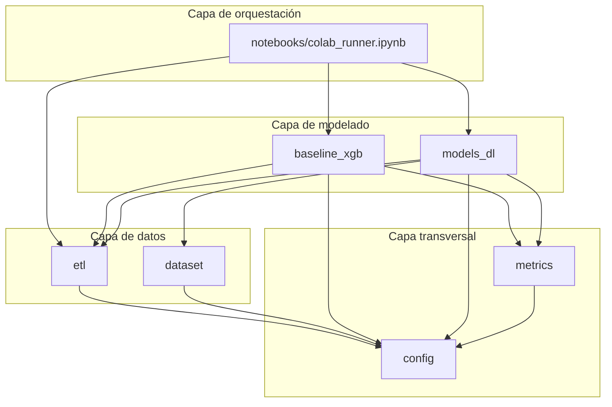

# 03 · Arquitectura lógica y componentes

Define **qué módulos existen, qué responsabilidad tiene cada uno y qué contratos respetan**. El flujo de ejecución está en [02](02_process_architecture.md); la justificación de dominio, en [01](01_domain_theory.md).

> **Estado.** ✅ implementado · 🚧 firma y docstring definidos, pendiente de implementación.

---

## 1. Capas del sistema



Las flechas indican "depende de". **Las dependencias solo apuntan hacia abajo**:

- `config` no importa ningún módulo del proyecto.
- `metrics` solo depende de NumPy y `config`: se puede probar sin PyTorch, XGBoost ni datos.
- `etl` no conoce ningún modelo.
- `baseline_xgb` y `models_dl` no se conocen entre sí. Comparten datos y métricas, nada más.
- El notebook **orquesta, no implementa**. Si una celda crece, su lógica pasa a `src/`.

| Módulo | Estado | Dependencias externas |
|---|---|---|
| `config` | ✅ | Ninguna |
| `metrics` | ✅ | numpy |
| `etl` | ✅ | kagglehub, pandas, pyarrow, scikit-learn, joblib |
| `dataset` | 🚧 | numpy, pandas, torch |
| `baseline_xgb` | ✅ | pandas, xgboost |
| `models_dl` | 🚧 | numpy, torch |

---

## 2. Contratos de datos

Notación: `B` = batch, `W` = ventana (30), `F` = features (15 en FD001), `N` = filas.

| Contrato | Forma | Tipo | Productor → consumidor |
|---|---|---|---|
| Tabla cruda | `(N, 26)` | float / int | `.txt` → `etl` |
| Tabla procesada | `(N, 2 + F + 2)` | float64 las features, int64 el resto | `etl` → `dataset`, `baseline_xgb` |
| Matriz tabular | `(N, F · (1 + 2 · n_ventanas))` | float | `baseline_xgb` (interno) |
| Ventana | `(W, F)` | float32 | `dataset` (interno) |
| **Batch de entrada** | **`(B, W, F)`** = `(batch_size, window_size, num_features)` | float32 | `dataset` → `models_dl` |
| **Batch de target** | **`(B,)`** | float32 | `dataset` → `models_dl` |
| Predicción | `(B,)` o `(N,)` | float | modelos → `metrics` |

### Esquema de la tabla procesada

| Columna | Rol | ¿Es feature? |
|---|---|---|
| `unit_id` | Clave de agrupamiento | No |
| `cycle` | Orden temporal | No |
| `s_*` (F columnas) | Sensores escalados | **Sí** |
| `rul` | Target, en [0, 125] | No |
| `rul_raw` | RUL sin recortar | No |

Invariantes: sin nulos, ordenada por (`unit_id`, `cycle`), ciclos consecutivos dentro de cada motor y `0 <= rul <= 125`.

### Unidades

Target y predicciones se expresan siempre **en ciclos** al cruzar el límite de un módulo. Si una red escala el target internamente, lo revierte antes de devolver la predicción.

### El error de forma que hay que evitar

Si un modelo devuelve `(B, 1)` y el target es `(B,)`, tanto NumPy como PyTorch hacen broadcasting a `(B, B)` y calculan una pérdida sin sentido **sin lanzar un error** (PyTorch emite solo una advertencia). Por eso el contrato fija la salida en `(B,)`, y `metrics` unifica las formas antes de restar.

---

## 3. Componentes

### 3.1 `config` ✅

| | |
|---|---|
| **Responsabilidad** | Única fuente de rutas, nombres de columnas y constantes |
| **Entradas** | Variables de entorno `NASA_RUL_ROOT` y `COLAB_RELEASE_TAG` |
| **Salidas** | `STORAGE_ROOT` y derivadas; `RUL_CLIP`, `WINDOW_SIZE`, `RAW_COLS`; constructores de rutas |
| **Regla** | Importarlo no toca el disco. Solo `ensure_directories()` crea carpetas |

### 3.2 `etl` ✅

| | |
|---|---|
| **Responsabilidad** | De Kaggle a tablas limpias, particionadas y escaladas |
| **Entradas** | Nombre del subset (`"FD001"`) |
| **Salidas** | `ETLResult(subset, train, val, test, feature_cols, scaler)` y los artefactos en disco |
| **Funciones** | Extract: `extract`, `download_dataset`, `backup_raw`, `read_raw_table`, `read_test_rul` · Transform: `add_train_rul`, `add_test_rul`, `split_by_unit`, `select_feature_columns`, `fit_scaler`, `apply_scaler` · Load: `save_artifacts`, `load_artifacts` · `run_etl` |
| **Anti-leakage** | Split por motor; poda y scaler aprendidos solo de Train |
| **Validaciones** | 26 columnas, sin nulos, ciclos consecutivos. `load_artifacts` falla si los artefactos se generaron con otros parámetros de `config` |
| **Alcance** | Pensado para FD001. En FD002 y FD004 funciona pero advierte que no normaliza por régimen |

Las funciones de Transform son puras: reciben y devuelven DataFrames, sin leer ni escribir disco. Así se prueban con datos sintéticos.

### 3.3 `dataset` 🚧

| | |
|---|---|
| **Responsabilidad** | De tabla 2D a tensores 3D |
| **Entradas** | DataFrame procesado, `feature_cols`, `window_size` |
| **Salidas** | `DataLoader` que emite `(B, W, F)` y `(B,)`; `make_last_windows` para Test |
| **Anti-leakage** | La ventana no cruza motores ni mira el futuro; se arma después del split |

```
 Motor con n = 34 ciclos, W = 30   →   n − W + 1 = 5 ventanas

 ciclo:     1  2  3  4  5 ........................ 30 31 32 33 34
 ventana 1: [━━━━━━━━━━━━━━━━━━━━━━━━━━━━━━━━━━━━━━━]            y = RUL(30)
 ventana 2:    [━━━━━━━━━━━━━━━━━━━━━━━━━━━━━━━━━━━━━━━]         y = RUL(31)
 ventana 3:       [━━━━━━━━━━━━━━━━━━━━━━━━━━━━━━━━━━━━━━━]      y = RUL(32)
 ventana 4:          [━━━━━━━━━━━━━━━━━━━━━━━━━━━━━━━━━━━━━━━]   y = RUL(33)
 ventana 5:             [━━━━━━━━━━━━━━━━━━━━━━━━━━━━━━━━━━━━━━━] y = RUL(34)
```

En FD001 resultan **14.241 ventanas de Train y 3.490 de Val**. El `shuffle` mezcla ventanas enteras dentro de Train y nunca los pasos dentro de una ventana.

**Motores cortos.** El motor más corto de Test tiene 31 ciclos en FD001, 21 en FD002, 38 en FD003 y 19 en FD004. Con `W = 30` hay 6 motores de FD002 y 11 de FD004 que requieren relleno a la izquierda.

### 3.4 `metrics` ✅

| | |
|---|---|
| **Responsabilidad** | Medir el error de predicción |
| **Entradas** | `y_true`, `y_pred` con forma `(n,)` o `(n, 1)`, en ciclos |
| **Salidas** | `rmse(...) -> float`, `nasa_asymmetric_score(...) -> float` |
| **Validaciones** | Falla ante formas incompatibles, vacíos, NaN o infinitos |
| **Convención** | `d = y_pred − y_true`; `d > 0` es tardía |

### 3.5 `baseline_xgb` ✅

| | |
|---|---|
| **Responsabilidad** | Establecer el piso de desempeño que las redes deben superar |
| **Entradas** | Artefactos del ETL, vía `load_artifacts(subset)` |
| **Salidas** | `models/xgb_baseline_FD001.json` y `metrics/xgb_baseline_FD001.json` (métricas, hiperparámetros y top 15 por gain) |
| **Funciones** | `add_rolling_features`, `get_model_feature_columns`, `train_xgb`, `predict_rul`, `evaluate_xgb`, `top_features_by_gain`, `run_baseline` |
| **Features** | Valor instantáneo + media y desvío en ventanas de 5 y 15 ciclos: `15 × (1 + 2 × 2) = 75` |
| **Anti-leakage** | Rolling causal y por motor; sin `unit_id`, `cycle` ni RUL como features; early stopping sobre Val |
| **CLI** | `--subset`, `--n-estimators`, `--max-depth`, `--learning-rate`, `--windows` |

### 3.6 `models_dl` 🚧

| | |
|---|---|
| **Responsabilidad** | Arquitecturas secuenciales y su entrenamiento |
| **Entradas** | `DataLoader` con `(B, W, F)` y `(B,)`; `TrainConfig` |
| **Salidas** | `models/{lstm,cnn1d}_FD001.pt`, `TrainHistory` y métricas |
| **Anti-leakage** | Checkpoint y early stopping por RMSE de Val |

```
 TurbofanLSTM                                TurbofanCNN1D
 ────────────                                ─────────────
 (B, 30, 15)                                 (B, 30, 15)
     │                                           │ permute(0, 2, 1)
     ▼                                           ▼
 LSTM × 2 capas, H = 64                      (B, 15, 30)
     │                                           │ Conv1d 32 → 64 → 64, k = 5
     ▼                                           ▼
 (B, 30, 64)                                 (B, 64, 30)
     │ último paso temporal                      │ pooling global
     ▼                                           ▼
 (B, 64)                                     (B, 64)
     │ MLP                                       │ MLP
     ▼                                           ▼
 (B,)                                        (B,)
```

`nn.LSTM` se usa con `batch_first=True`. `nn.Conv1d` espera los canales en el eje 1, de ahí el `permute`, que ocurre **dentro** del modelo para mantener un único contrato de entrada.

---

## 4. Reglas anti-leakage por módulo

| Módulo | Riesgo | Defensa |
|---|---|---|
| `etl` | Mismo motor en Train y Val | `GroupShuffleSplit` por `unit_id` más verificación de intersección vacía |
| `etl` | Estadísticos de Val o Test en el scaler o en la poda | `fit_scaler` y `select_feature_columns` reciben solo Train |
| `dataset` | Ventana que une el final de un motor con el inicio de otro | Índices calculados por `unit_id` |
| `dataset` | Ventana con ciclos posteriores a la etiqueta | Ventana `[t − W + 1, t]` con etiqueta en `t` |
| `baseline_xgb` | Rolling centrado o sin agrupar | `groupby(unit_id)` y sin `center=True` |
| `baseline_xgb`, `models_dl` | Identificadores o targets como features | Solo se usa `feature_cols` |
| `models_dl` | Elegir la época según Test | Early stopping solo con Val |

---

## 5. Enfoque tabular frente a secuencial

### 5.1 Comparativa

| Aspecto | XGBoost + rolling | LSTM | CNN 1D |
|---|---|---|---|
| Entrada | `(N, 75)` | `(B, 30, 15)` | `(B, 30, 15)` |
| Representación del tiempo | Manual: media y desvío móviles | Aprendida: estado recurrente | Aprendida: filtros locales |
| Sesgo inductivo | Umbrales e interacciones entre estadísticos | Orden y memoria a lo largo de la ventana | Patrones locales invariantes a la posición |
| Campo temporal | El de la mayor ventana (15 por defecto) | Toda la ventana | `1 + 3 × (5 − 1) = 13` pasos con 3 capas y k = 5; el pooling cubre el resto |
| Paralelismo temporal | No aplica | Bajo: secuencial por paso | Alto |
| Extrapolación | Nula: no predice fuera del rango visto | Posible, no garantizada | Posible, no garantizada |
| Interpretabilidad | Alta (importancias, SHAP) | Baja | Media (filtros, saliencia) |
| Necesidad de datos | Baja | Media a alta | Media |
| Hardware | CPU | GPU | GPU |
| Riesgo principal | Features mal elegidas | Sobreajuste e inestabilidad | Perder el orden global por el pooling |

### 5.2 Lectura desde el dominio

La degradación de FD001 es **lenta, suave, casi monótona y ruidosa**. De ahí se desprenden hipótesis, que el proyecto debe contrastar y no dar por ciertas:

- **H1. El baseline tabular será competitivo.** La media móvil captura bien una tendencia suave, y con solo 80 motores independientes hay pocos datos para redes grandes.
- **H2. La CNN 1D entrenará más rápido que la LSTM con un desempeño similar.** Sus filtros actúan como suavizadores aprendidos, adecuados para este tipo de señal.
- **H3. La LSTM aportará más donde importa el orden**, por ejemplo con `s_9` y `s_14`, cuyo sentido cambia según el motor.
- **H4. La diferencia entre modelos se verá más en el NASA score que en el RMSE**, porque el score está dominado por los errores tardíos extremos.

> **Cantidad de datos efectiva.** Las 14.241 ventanas de Train no son muestras independientes: las consecutivas comparten 29 de 30 filas. El número que gobierna la generalización es el de **motores (80)**. Diferencias pequeñas en Val (20 motores) o Test (100) deben leerse con cautela; conviene repetir con varias semillas.

### 5.3 Criterio de decisión

1. Se comparan modelos sobre las **mismas filas** de Val (ver [02, sección 5](02_process_architecture.md#5-protocolo-de-evaluación)).
2. Una red se adopta solo si mejora al baseline **en ambas métricas** o si mejora con claridad el NASA score sin degradar el RMSE.
3. A desempeño equivalente, se prefiere el modelo más simple e interpretable.
